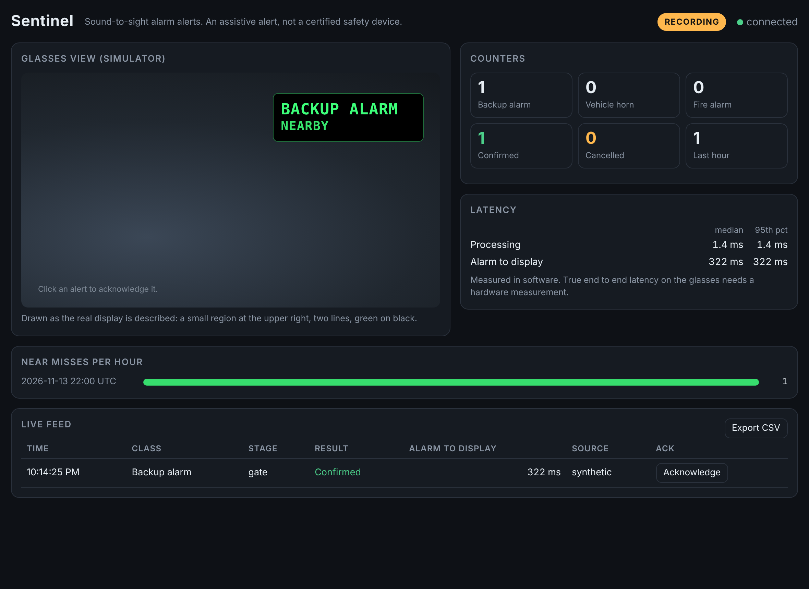
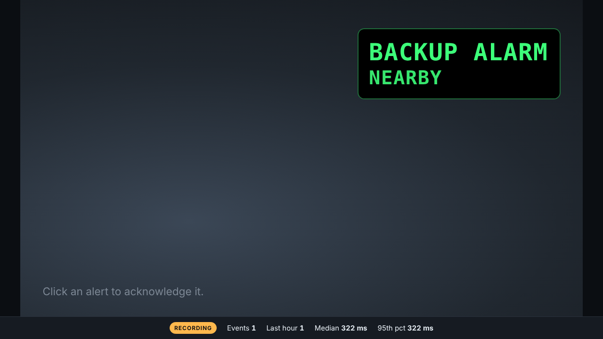

# Sentinel

Sound-to-sight alerts for workers whose hearing is blocked by protection or reduced by loss. Sentinel listens for reversing alarms, vehicle horns and fire alarms and shows a two-word alert (for example `BACKUP ALARM` / `NEARBY`) on smart glasses, or on a browser simulator of them. Every alert is logged as a near-miss event.

**Sentinel is an assistive alert, not a certified safety device. It does not prevent accidents.** This is not a new concept: sound-to-sight on glasses has been researched. What Sentinel offers is a deployable combination for hearing-protected workers, with no retrofit to vehicles and a near-miss log.

Built for the Worn smart glasses hackathon (Nov 20 to 21, 2026). The core runs and is fully tested on a laptop. Everything that depends on the MicroLumin glasses is behind two adapter slots, with stubs, until the SDK is known. The spec is in [`docs/SPEC.md`](docs/SPEC.md).



*The dashboard in demo replay mode (note the RECORDING badge). The black box is the glasses-view simulator.*



For judges: [`docs/ONE_PAGER.md`](docs/ONE_PAGER.md) is a one-page summary with the claims that are verified and the numbers still to fill in.

## How it works

```
mic or wav -> ring buffer -> 1. tonal gate (fast, pulsed alarms)    -> policy -> display adapter -> glasses, bridge or simulator
                          -> 2. YAMNet classifier (confirms class)  -> policy -> event log (SQLite) -> dashboard
```

The tonal gate shows a provisional alert within about 0.3 s of a pulsed backup alarm. The classifier (YAMNet) confirms it, and covers horns, fire alarms and wideband alarms. The policy shows one alert at a time, applies cooldowns and cancels unconfirmed alerts. Nothing needs the network after the model download, and raw audio is never stored unless you pass `--record`.

## Install

Python 3.11 or newer. On Linux, the microphone needs PortAudio: `sudo apt install libportaudio2`.

```bash
python3 -m venv .venv
source .venv/bin/activate
pip install -e ".[dev,classifier]"
```

Download the classifier model once (the only step that needs the network). Afterwards everything runs offline:

```bash
python tools/fetch_models.py
```

With `uv` instead of pip: `uv venv .venv && uv pip install -e ".[dev,classifier]"`.

Classifier runtime: `ai-edge-litert` (installed by the `classifier` extra, works on Python 3.13). The code falls back to `tflite-runtime`, then `tensorflow`, if those are installed instead. Check the setup with:

```bash
python -m sentinel check-config
python -m sentinel check-models
```

## Run the tests

```bash
pytest
ruff check .
```

The tests that need the model skip themselves if you have not run `fetch_models.py`. The suite takes about a minute.

## Run a synthetic replay

```bash
python tools/run_replay.py scenarios/tonal_10db.yaml
```

This renders a synthetic 1900 Hz, 70 pulses per minute backup alarm in pink noise, and prints a provisional detection, then confirmed detections, then the alert and its latency. Replays are tagged `synthetic` in the event log. Useful options:

| Command | What it does |
|---|---|
| `python tools/run_replay.py my_clip.wav` | Replay a recording. Tagged `replay`. |
| `python tools/run_replay.py my_clip.wav --scores` | Print the classifier's class scores every 0.25 s. |
| `python tools/run_replay.py scenarios/tonal_10db.yaml --no-classifier` | Gate only, no model needed. |
| `python tools/run_replay.py scenarios/tonal_10db.yaml --db /tmp/x.sqlite` | Write events to a throwaway database. |

## Run live with the microphone

```bash
python tools/run_live.py --sim
```

Play a backup alarm or a horn near the laptop. The alert prints on the console, and (because of `--sim`) also appears in the browser simulator. Processing latency is printed for every event. Stop with Ctrl+C.

```bash
python tools/run_live.py --list-devices          # find your microphone
python tools/run_live.py --device 2 --sim        # pick a device by index or name
python tools/run_live.py --record                # also save raw audio to data/recordings/
python tools/run_live.py --no-classifier         # gate only
```

Recording is off by default. `--record` is the only way raw audio is ever written, and it goes to `data/recordings/` (gitignored). Live events are tagged `live`.

## Open the dashboard and the glasses simulator

The dashboard starts automatically when you use `--sim` (or `--display bridge`). By default it listens on http://127.0.0.1:8765/. To watch a replay in the browser at real-time speed:

```bash
python tools/run_replay.py scenarios/demo.yaml --serve
```

Then open http://127.0.0.1:8765/. You get:

- **Glasses view:** a dark rectangle at the upper right with two lines of green text, blinking for urgent alerts. Click an alert to acknowledge it.
- **Counters, latency and near-miss view:** events per class, confirmed versus cancelled, median and 95th percentile latency, and events per hour.
- **Live feed:** every event with time, class, stage, result and alarm-to-display latency, an acknowledge button and a CSV export (`/api/events.csv`).
- **Kiosk mode:** http://127.0.0.1:8765/?kiosk=1 is the full-screen simulator with a compact stats strip, for the demo table.
- **RECORDING badge:** shown whenever the source is a recording or synthetic scenario instead of the live microphone.

Latency on the page is software latency (up to the moment the display call returns). True end-to-end latency to visible photons needs hardware, see `tools/latency_probe.py`.

## Start demo mode

```bash
python tools/demo.py
```

One command starts the pipeline, the dashboard, the simulator and the console display, and opens the kiosk page in your browser. It uses the live microphone. If the microphone cannot be opened, it falls back to a replay and says so: the console banner reads `NOT LIVE`, the page shows the `RECORDING` badge and events are tagged `replay` or `synthetic`. The demo never presents a recording as live.

```bash
python tools/demo.py --mode replay                       # labeled replay of scenarios/demo.yaml
python tools/demo.py --mode replay --input my_demo.wav   # replay your own recorded clip
python tools/demo.py --strict                            # need 3 of 3 classifier windows: fewer false alerts
python tools/demo.py --no-browser                        # print the address only
python tools/demo.py --no-kiosk                          # open the full dashboard
python tools/demo.py --no-fallback                       # fail instead of replaying if there is no mic
```

The demo event log is `data/demo_events.sqlite` and starts empty each time (`--keep-log` keeps it).

### Demo checklist (event day)

1. `python tools/demo.py --mode replay` once, so you know the fallback works and what it looks like.
2. Plug in the external microphone and speaker. `python tools/run_live.py --list-devices`, then `python tools/demo.py --device N`.
3. Check the badge says LIVE (not RECORDING) before you start. The banner in the terminal says which.
4. Play the alarm clips through the speaker. Say they are speaker-played recordings.
5. If something breaks, `python tools/demo.py --mode replay` is the backup, clearly labeled.

What to say: the numbers on stage must come from your own recordings (see below), say what was built before the event, and never claim Sentinel prevents accidents.

## Evaluate and build your real test set

Every number shown on stage must come from your own recordings, made through the same microphone path as the event. Follow [`docs/RECORDING_GUIDE.md`](docs/RECORDING_GUIDE.md), then:

```bash
python tools/make_test_set.py --init-manifest             # blank licence rows for your clips
python tools/make_test_set.py --heldout-session day2_office
python tools/evaluate.py scenarios/generated/*.yaml --split dev --sweep-thresholds
python tools/evaluate.py scenarios/generated/*.yaml --split heldout
```

Reports go to `reports/` and always say at the top whether the audio was SYNTHETIC or REAL. To exercise the tooling without recordings (development only, never a performance claim):

```bash
python tools/evaluate.py --synthetic-suite --quick
```

[`reports/example_synthetic.md`](reports/example_synthetic.md) shows the format. Its numbers are synthetic.

## Hardware integration

The glasses and their SDK are not available yet. Two slots exist, both stubs that raise `NotImplementedError` with a clear message:

| Slot | File | Until known |
|---|---|---|
| Glasses display | `src/sentinel/adapters/display_microlumin.py` | console, simulator, or the phone bridge |
| Glasses microphone | `src/sentinel/adapters/audio_glasses.py` | external microphone (`--input mic`) |

The preferred architecture is a **bridge**: the laptop core publishes alert messages over WebSocket and a small phone app or script forwards them to the glasses. Try it without hardware:

```bash
python tools/run_replay.py scenarios/tonal_10db.yaml --display bridge --realtime --no-classifier
python tools/bridge_echo.py          # second terminal: prints the alerts the core sends
```

When hardware information arrives, paste it into [`docs/SDK_NOTES.md`](docs/SDK_NOTES.md); it lists what to fill in and which file changes for each fact. Once an adapter exists:

```bash
python tools/hw_smoke_test.py --display bridge    # show, clear, time 20 calls, print numbers
python tools/latency_probe.py --mode live --display bridge   # timestamps for slow-motion video timing
```

## Configuration

`config/default.yaml` holds every threshold. It is validated on load: unknown keys and unknown class names fail with a clear message. A hash of the active config is stored in every event. The gate band (800 to 3000 Hz), the 1.9 kHz pitch and the 0.30 classifier thresholds are starting assumptions from public alarm specs. Tune them on your own recordings.

Display size, color and blink support (`display.caps`) are assumptions until the SDK docs confirm them.

## Repository layout

```
config/default.yaml        all thresholds and settings
docs/                      SPEC, DECISIONS (every open choice), SDK_NOTES, RECORDING_GUIDE
models/                    downloaded model files (gitignored) and models/README.md with checksums
data/                      your clips and recordings (gitignored); ATTRIBUTIONS.md is tracked
scenarios/                 YAML scenario files (synthetic); scenarios/generated/ is local
reports/                   evaluation reports and the report template
src/sentinel/              types, config, buffer, gate/tonal.py, classify/yamnet.py, policy.py,
                           eventlog.py, metrics.py, pipeline.py, adapters/, dashboard/, sim/
tools/                     fetch_models, run_live, run_replay, evaluate, make_test_set,
                           latency_probe, hw_smoke_test, demo, bridge_echo
tests/                     pytest suite
```

## Troubleshooting

| Problem | Fix |
|---|---|
| `sounddevice could not load PortAudio` | Linux: `sudo apt install libportaudio2`. macOS and Windows wheels include it. |
| No microphone or wrong one | `python tools/run_live.py --list-devices`, then `--device N`. On macOS allow the terminal to use the microphone. |
| `Model not found ... fetch_models` | `python tools/fetch_models.py` (needs network once), or use `--no-classifier`. |
| `Could not start the dashboard ... port` | Another program uses port 8765. Change `dashboard.port` in the config. |
| Page opens but shows no alerts | Start with `--sim` (or `tools/demo.py`). The default display is the console only. |
| `INFO: Created TensorFlow Lite XNNPACK delegate` | A harmless message from the TFLite runtime when the model loads. |

## What is verified and what is not

- Verified by tests on synthetic audio: gate behaviour, policy, event log, dashboard, bridge, evaluation tooling.
- Verified on one real audio clip: the classifier loads offline and produces sensible class scores (a cat meow scored `Cat`). No real alarm recording has been tested yet.
- Not verified: the live microphone path on real hardware, recall and false alerts on real alarms, anything involving the glasses. Those need your recordings and the SDK.
- Latency figures printed by the tools are software only.
